# Hypomnema

*[English](#english) · [Français](#français)*

**Documentation: [hypomnema.tools](https://hypomnema.tools)** — concepts, method notes, integrations (Dataview, QuickAdd, Templater, Kanban, Tasks), API. · **Documentation : [hypomnema.tools/fr](https://hypomnema.tools/fr/)** — concepts, notes de méthode, intégrations, API.

## English

Hypomnema is an Obsidian plugin for augmented reading, reflection and knowledge organisation. Comment on a passage, or on a precise point, of any note. Write, reply and navigate in a side panel, much like the comments pane in Word. Classify your comments into coloured categories linked to tags. It works especially well with web articles saved through the [Obsidian Web Clipper](https://obsidian.md/clipper), the official browser extension that turns a web page into a Markdown note: the source text and your remarks never get mixed up.

Comments are stored as plain text inside the note itself. They are searchable, they sync with the rest of your vault, and they remain readable without the plugin.

> The plugin's interface follows Obsidian's language: French when Obsidian is set to French, English otherwise.

### A tour in eight steps

The screenshots below come from the sample vault in [`demo-vault/`](demo-vault/), with real Obsidian and the real plugin, in Live Preview.

**1. The text, and the thinking next to it.** Commented passages get a light tint and an underline in their category's colour. The *Comments* panel on the right lists every comment in text order, with the quoted passage, the date, the category and the replies. The note itself stays readable: no inline clutter, no footnotes to scroll to.

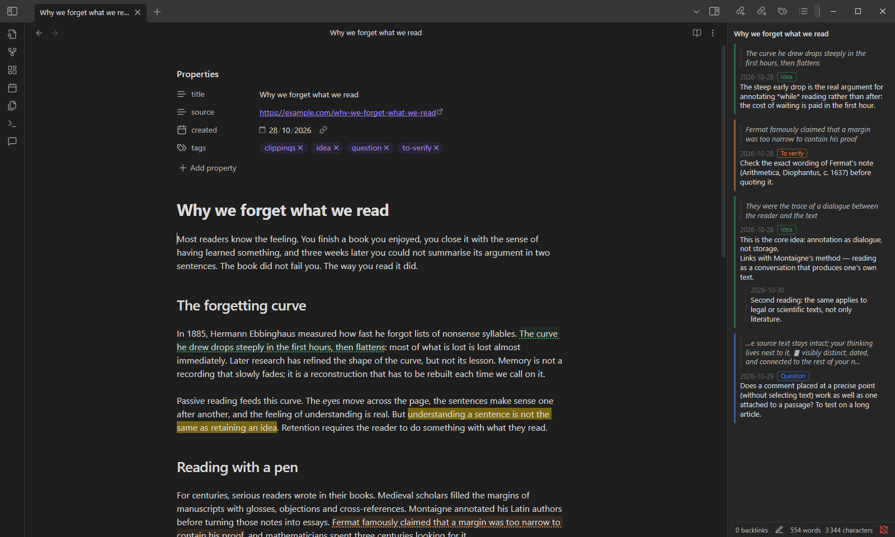

**2. Writing without hiding the text.** Select a sentence and run the command. The draft opens in the panel, beside the passage, not in a pop-up that covers it. Pick a category, write, then press Ctrl+Enter.

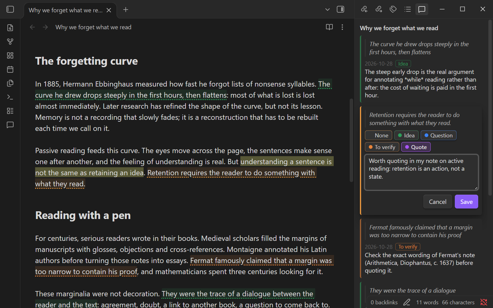

**3. Metadata that follows your reading.** Saving a comment in the *Quote* category added the `quote` tag to the note's properties. Your reading now shows up in tag searches, the tags pane and Dataview queries, with no manual tagging. Remove the last *Quote* comment and the tag goes away, unless you had set it yourself.

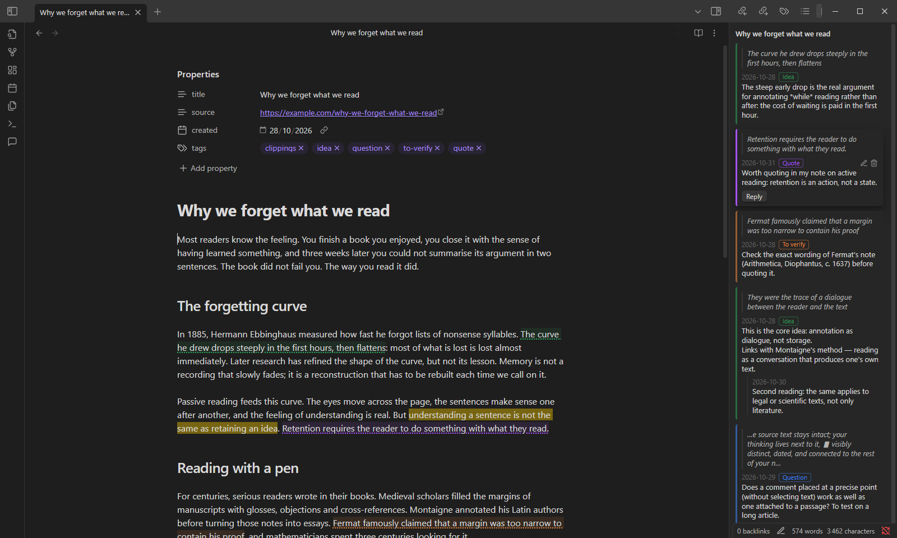

**4. Commenting on a point, not just a passage.** With no selection, the comment is attached to the cursor position and shows as a small bubble in the text. Click it, and the panel brings up its thread, along with a few words of context around the point.

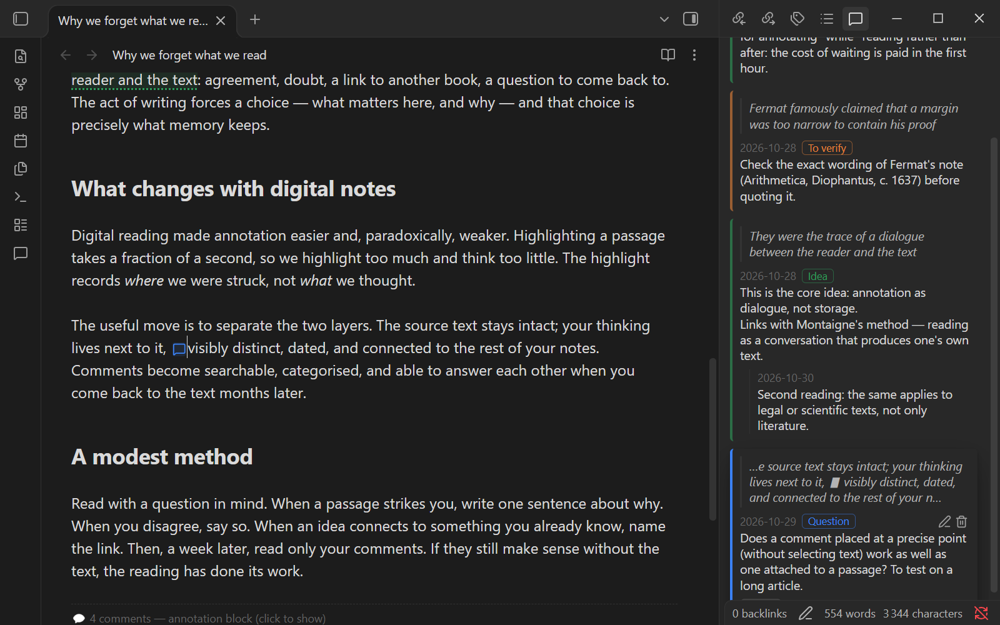

**5. Comments are searchable across the vault.** *Diophantus* appears only in a comment, never in the article. Obsidian's ordinary search still finds the note, because comments are plain text inside it.

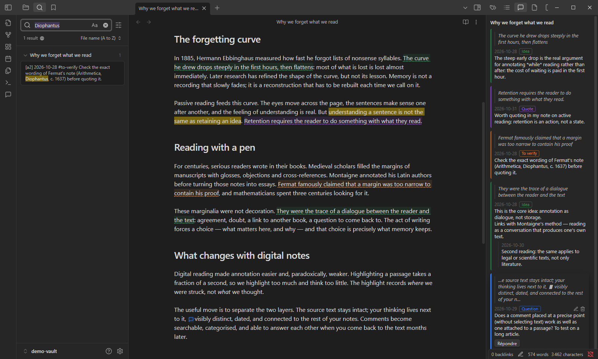

**6. Your own categories.** Each category is a name, a colour and a tag: *Idea*, *Question*, *To verify*, *Quote*, or whatever suits your way of reading.

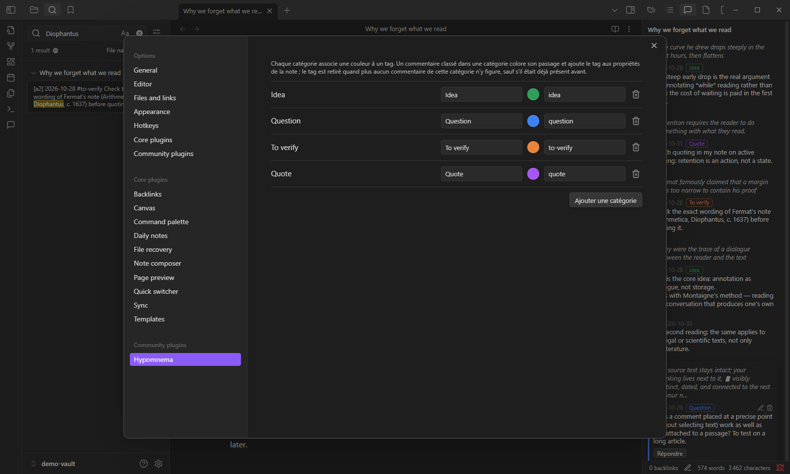

Steps 7 and 8 are optional. Both are off until you turn them on, and neither changes how comments are stored. They exist for one reason: an annotation tool should help you take your thinking back, not keep it for you. Writing a comment hands a thought over to the machine; these two features are about getting it back, rereading it and reworking it. Florian Ernotte develops the idea, in French, under the name [*operational dispossession*](https://reflexions.florianernotte.be/post/depossession-operatoire/).

**7. Comments in the margin.** Turn on *Comments in the margin* in *Settings → Hypomnema*, or run the command *Show or hide comments in the margin*. Each comment then sits beside its passage, like a note pencilled in the margin of a book, in the colour of its category. Hover a note to highlight its passage; click it to open the thread in the panel, where you still write and reply. *Margin content* shows either the comment alone or the whole thread.

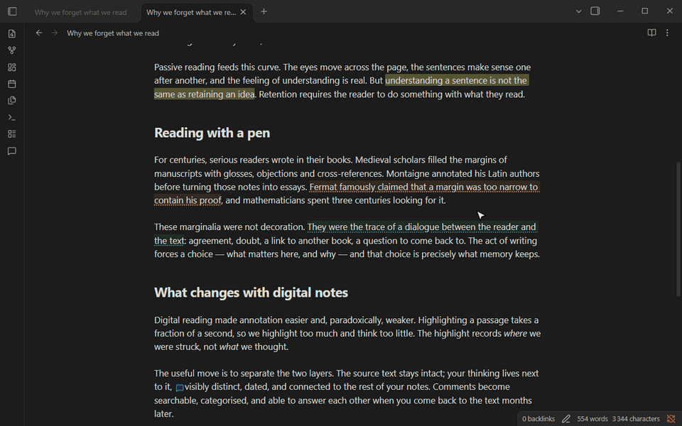

When the pane is too narrow for a margin (with the side panel open, or on a small screen), each comment moves below its paragraph instead.

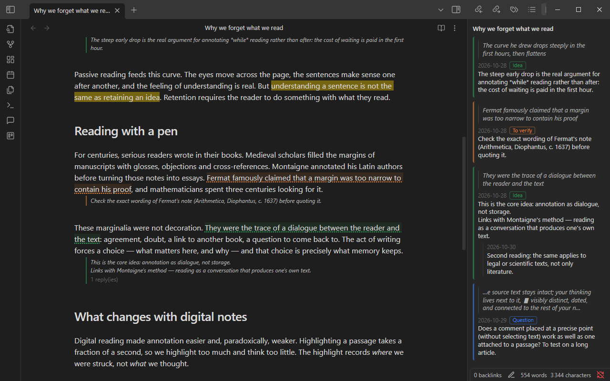

*Why it matters:* in the panel, your comments live in a tool beside the text. In the margin, you reread yourself while rereading the source, and the dialogue between the two stays in view.

**8. Extract your comments into a note.** The command *Extract comments from this note*, or a right-click on a folder → *Extract comments from this folder*, copies your comments into a separate note. You choose the format: a list grouped by category, a table, or a Kanban board with one column per category and a *Done* column. Each comment ends with a ↩ link that reopens the source note and selects the passage. Running the extraction again only adds the comments written since: cards you have moved or ticked stay where they are.

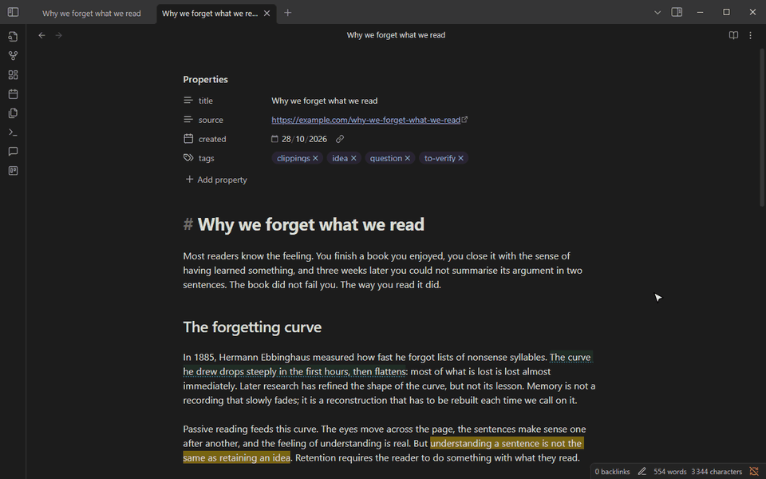

The format, the destination folder, the note name and the line template (`{{text}}`, `{{quote}}`, `{{category}}`, `{{date}}`, `{{note}}`, `{{link}}`…) are set in *Settings → Hypomnema*.

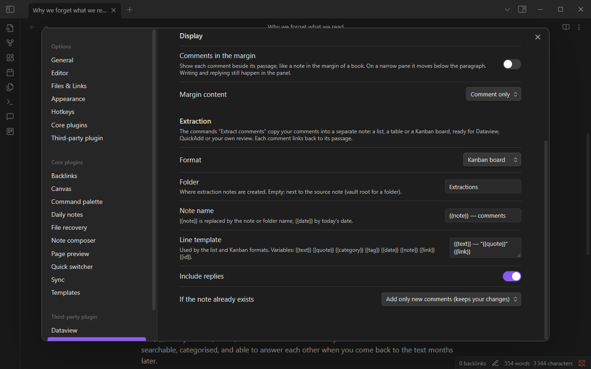

The extraction note carries properties (`hypomnema-extract`, `hypomnema-source`, `hypomnema-date`), so Dataview finds it, and its items are ordinary tasks. The [recipes](docs/recipes.md) and the [integration pages](https://hypomnema.tools/integrations/dataview/) give ready-made queries, a review board workflow and a QuickAdd macro.

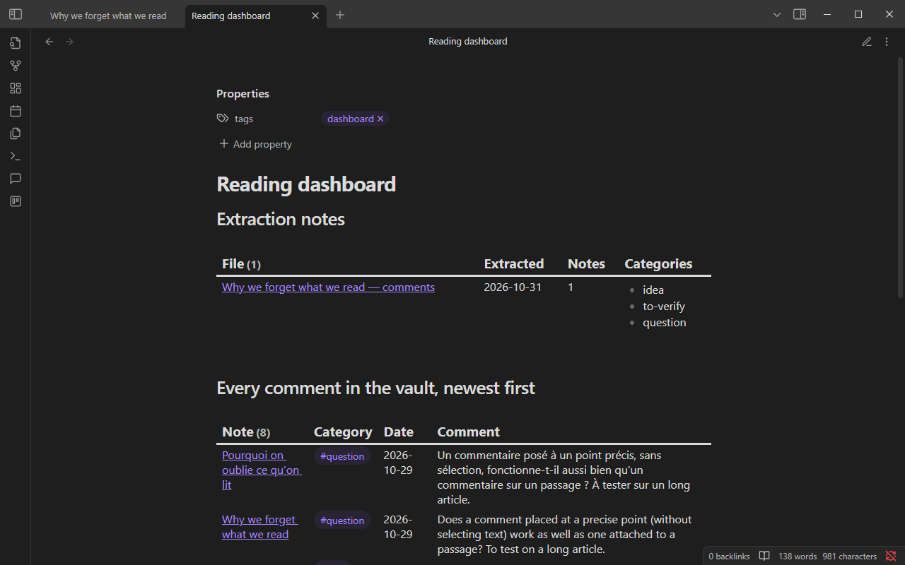

*Why it matters:* a comment is worth something only when you come back to it. Extraction turns your comments into material you rework: you sort them, drop some, turn others into tasks or into writing. Otherwise they stay as traces stored on your behalf.

### Usage

- **Comment**: select a passage, or just place the cursor, then right-click (*Comment on selection* / *Comment here*) or use the command palette. For speed, assign a hotkey to the command *Comment on selection or cursor* in *Settings → Hotkeys*; Ctrl+Alt+M, the Word shortcut, works well. You write in the right-hand panel, so the text stays visible. Ctrl+Enter saves and Esc cancels.
- **Categories**: while writing, pick a category (a coloured chip). It colours the passage and adds its tag to the note's properties. Categories (name, colour, tag) are set in *Settings → Hypomnema*.
- **In the note**: a commented passage is underlined, and a comment placed at the cursor shows as a small bubble. Click either one to open its thread in the panel.
- **Panel**: a *Comments* tab sits in the right sidebar, next to backlinks, outgoing links and the outline. It lists the note's comments in text order; click one to jump to its passage.
- **Reply / edit / delete**: each thread offers these actions. Deleting a comment removes its markers and leaves the source text untouched. Ctrl+Z undoes.
- **Search**: comments are text in the note, so Obsidian's search finds them across the vault. Category tags live in the note's properties and work with `tag:#…`, the tags pane and Dataview.
- **Margin** (optional): *Comments in the margin* in the settings, or the command *Show or hide comments in the margin*. Comments show beside their passage, or below the paragraph when the pane is narrow.
- **Extraction**: the command *Extract comments from this note*, or right-click a folder → *Extract comments from this folder*. It creates a list, a table or a Kanban board in a separate note. If that note already exists, it either adds only the new comments (default) or replaces the note, as set in the settings.

#### Automatic tags

When a comment gets a category, its tag is added to the note's `tags` property. The tag is removed when no comment of that category remains, unless the note already had that tag before. The plugin keeps track of the tags it added in its `data.json`.

### Storage format (for scripts)

A commented passage is wrapped in two Obsidian comments that share an id. A comment placed at the cursor is an empty anchor:

```text
The author argues that %%[a1%%memory is a reconstruction%%a1]%% rather than a recording.
A comment placed here %%[a2%%%%a2]%% without a selection.
```

The comment texts live in a single block at the end of the note:

```text
%% annotations
[a1] 2026-10-31 #idea First comment
    continued (indented continuation lines)
  [a1.1] 2026-11-04 Reply to comment a1
[a2] 2026-10-31 Comment without a category
%%
```

- A root comment has the id `aN`; its replies are `aN.k`, indented by two spaces.
- Each entry starts with `[id] YYYY-MM-DD`. An optional `#tag` (the category, root comments only) can follow, then the text. Indented lines that follow continue the entry.
- An uncategorised text that starts with `#` is written as `\#…`.
- `%%` is hidden in reading view, so the note stays clean without the plugin.
- Regex for a commented passage: `%%\[(a\d+)%%([\s\S]*?)%%\1\]%%`. For a cursor comment, group 2 is empty.
- A comment whose markers were deleted stays in the block. The panel flags it as orphaned.

### Limitations

The plugin works in Live Preview only. In reading view the markers are hidden, but passages are not underlined. Threads have a single level of replies, and each comment has a single category.

Margin comments appear in Live Preview and source mode, not in reading view. The margin needs empty space to the right of the text: with *Readable line length* turned off, comments go below their paragraph. An extraction note is a copy: editing it does not change the comments in the source note.

### Installation

Until the plugin is listed in the community directory, download `main.js`, `manifest.json` and `styles.css` from the [latest release](https://github.com/Floernt/hypomnema/releases/latest). Put them in `<vault>/.obsidian/plugins/hypomnema/`, then enable the plugin under *Community plugins*.

---

## Français

Hypomnema est un outil de lecture augmentée, de réflexion et d'organisation de la connaissance. Il permet de commenter un passage ou un point précis d'une note. On rédige, on répond et on navigue dans un panneau latéral, comme le volet des commentaires de Word. Les commentaires se classent par catégories de couleur reliées à des tags. Il convient particulièrement aux articles du web capturés avec l'[Obsidian Web Clipper](https://obsidian.md/clipper), l'extension officielle qui transforme une page web en note Markdown : le texte source et vos remarques ne se mélangent jamais.

L'interface du plugin suit la langue d'Obsidian : en français quand Obsidian est en français, en anglais sinon.

Les commentaires restent du texte brut dans la note : ils sont cherchables, synchronisables et lisibles sans le plugin.

### Visite en huit étapes

Les captures ci-dessous proviennent du coffre d'exemple [`demo-vault/`](demo-vault/), dans le vrai Obsidian, avec le vrai plugin, en Aperçu en direct.

**1. Le texte, et la réflexion à côté.** Les passages commentés reçoivent une teinte légère et un soulignement de la couleur de leur catégorie. Le panneau « Commentaires », à droite, liste tous les commentaires dans l'ordre du texte, avec le passage cité, la date, la catégorie et les réponses. La note reste lisible : rien n'encombre les lignes, aucune note de bas de page à aller chercher.

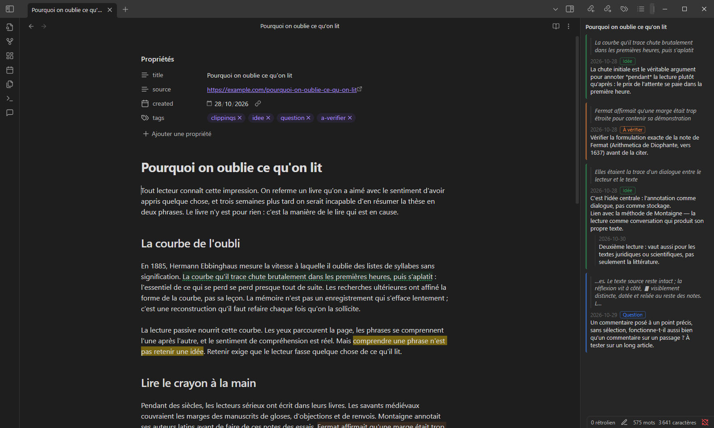

**2. Rédiger sans masquer le texte.** On sélectionne une phrase et on lance la commande. La rédaction s'ouvre dans le panneau, à côté du passage, et non dans une fenêtre qui le recouvre. On choisit une catégorie, on écrit, puis Ctrl+Entrée.

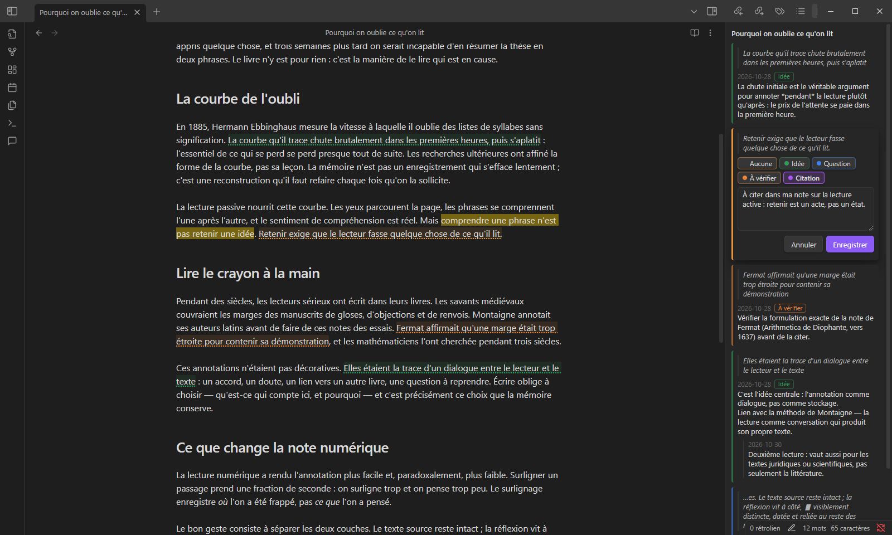

**3. Des métadonnées qui suivent la lecture.** Enregistrer un commentaire de la catégorie « Citation » a ajouté le tag `citation` aux propriétés de la note. La lecture apparaît désormais dans les recherches par tag, le volet des tags et les requêtes Dataview, sans étiquetage manuel. Si l'on supprime le dernier commentaire « Citation », le tag disparaît, sauf si on l'avait posé soi-même.

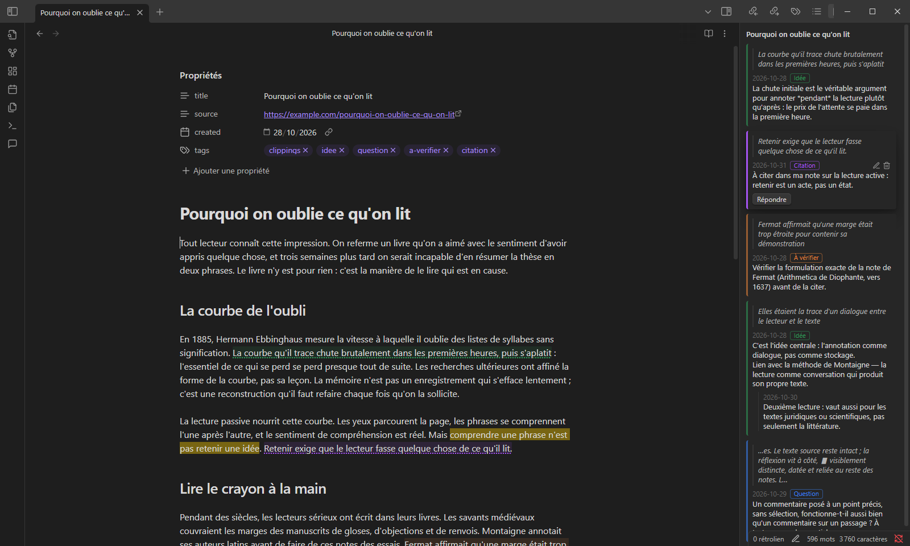

**4. Commenter un point, pas seulement un passage.** Sans sélection, le commentaire s'attache à la position du curseur et apparaît comme une petite bulle dans le texte. Un clic sur la bulle met son fil en avant dans le panneau, avec quelques mots de contexte autour.

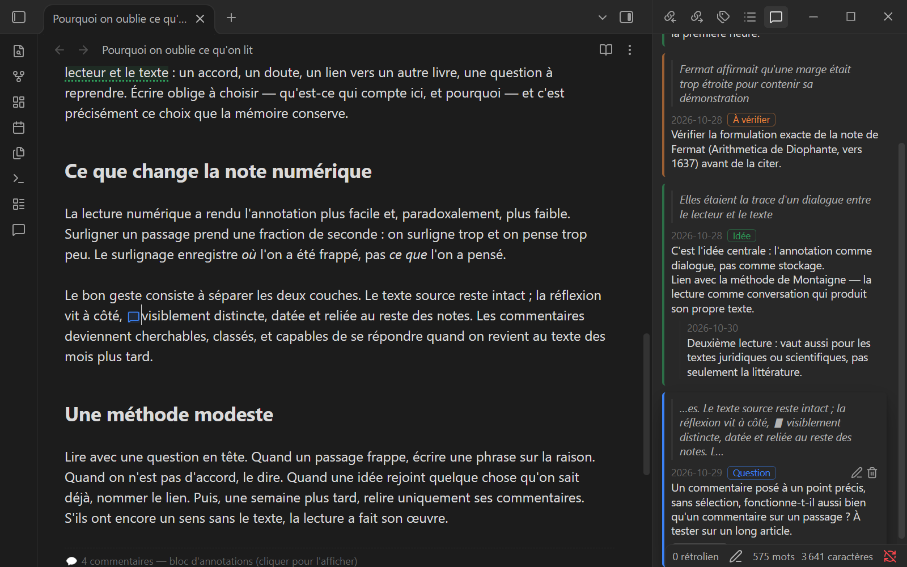

**5. Des commentaires cherchables dans tout le coffre.** « Diophante » ne figure que dans un commentaire, jamais dans l'article. La recherche ordinaire d'Obsidian retrouve pourtant la note, puisque les commentaires sont du texte brut qu'elle contient.

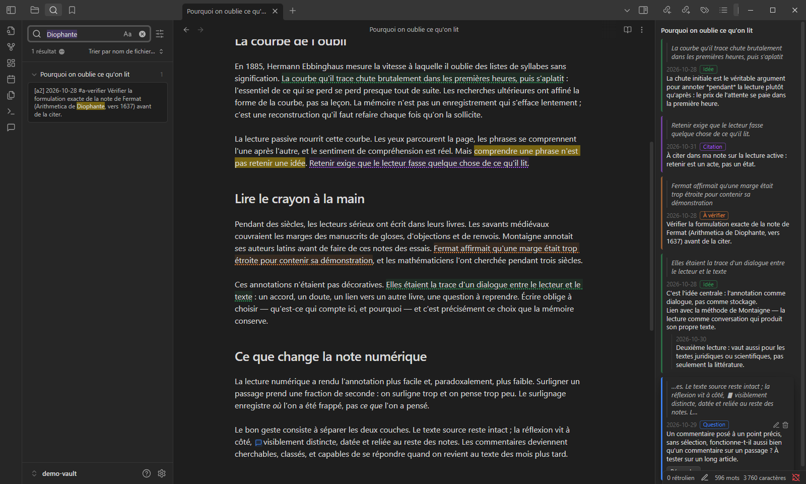

**6. Vos propres catégories.** Chaque catégorie associe un nom, une couleur et un tag : « Idée », « Question », « À vérifier », « Citation », ou ce qui convient à votre manière de lire.


Les étapes 7 et 8 sont facultatives. Ni l'une ni l'autre ne s'active tant qu'on ne la met pas en marche, et aucune ne modifie la manière dont les commentaires sont stockés. Elles répondent à une même intention : un outil d'annotation doit aider à reprendre sa pensée, pas la garder à sa place. Écrire un commentaire, c'est confier une réflexion à la machine. Ces deux fonctions servent à la récupérer, à la relire, à la retravailler. L'idée est développée sous le nom de [« dépossession opératoire »](https://reflexions.florianernotte.be/post/depossession-operatoire/).

**7. Les commentaires en marge.** On active *Commentaires en marge* dans *Paramètres → Hypomnema*, ou la commande *Afficher ou masquer les commentaires en marge*. Chaque commentaire s'affiche alors à côté de son passage, comme une note au crayon dans la marge d'un livre, dans la couleur de sa catégorie. Le survol d'une note met son passage en évidence. Un clic ouvre le fil dans le panneau, où l'on continue de rédiger et de répondre. Le réglage *Contenu de la marge* affiche le commentaire seul ou le fil entier.

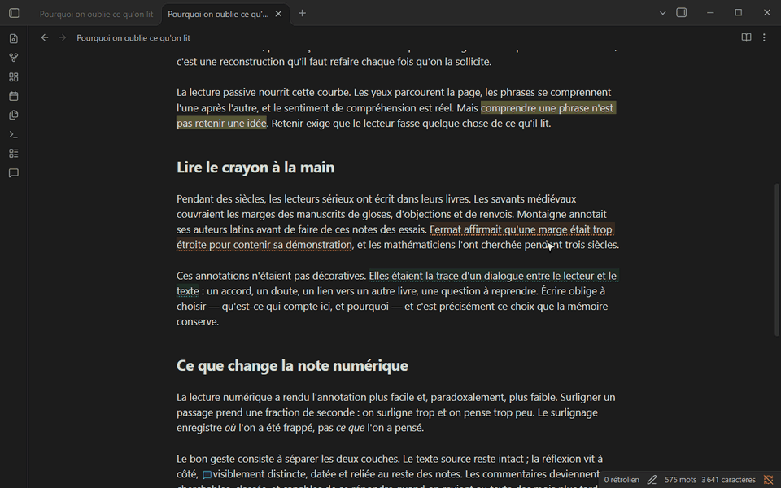

Quand la place manque pour une marge (panneau latéral ouvert, petit écran), chaque commentaire passe sous son paragraphe.

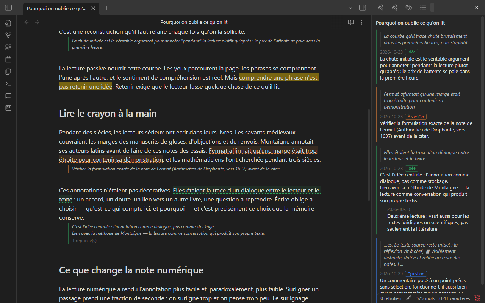

*Pourquoi :* dans le panneau, les commentaires vivent dans un outil à côté du texte. En marge, on se relit en relisant la source, et le dialogue entre les deux reste sous les yeux.

**8. Extraire ses commentaires dans une note.** La commande *Extraire les commentaires de cette note*, ou un clic droit sur un dossier → *Extraire les commentaires de ce dossier*, recopie les commentaires dans une note à part. Trois formats sont proposés : une liste par catégorie, un tableau, ou un tableau Kanban avec une colonne par catégorie et une colonne *Fait*. Chaque commentaire se termine par un lien ↩ qui rouvre la note source et sélectionne le passage. Une nouvelle extraction n'ajoute que les commentaires écrits depuis : les cartes déplacées ou cochées restent où elles sont.

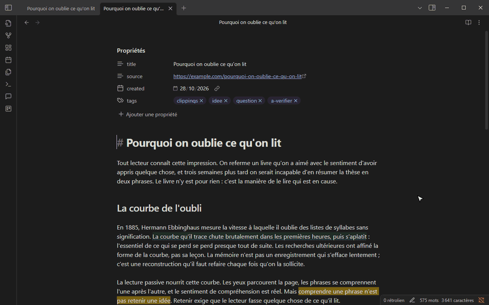

Le format, le dossier de destination, le nom de la note et le gabarit de ligne (`{{text}}`, `{{quote}}`, `{{category}}`, `{{date}}`, `{{note}}`, `{{link}}`…) se règlent dans *Paramètres → Hypomnema*.

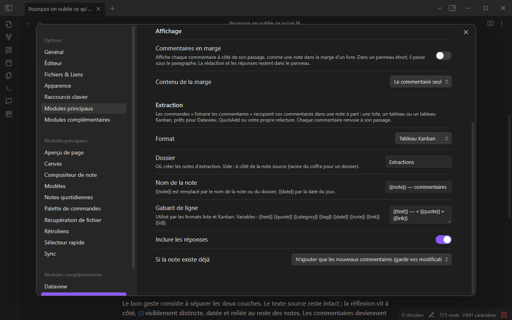

La note d'extraction porte des propriétés (`hypomnema-extract`, `hypomnema-source`, `hypomnema-date`) que Dataview sait retrouver, et ses éléments sont des tâches ordinaires. Les [recettes](docs/recipes.md#français) et les [pages d'intégration](https://hypomnema.tools/fr/integrations/dataview/) proposent des requêtes prêtes à l'emploi, une méthode de relecture en Kanban et une macro QuickAdd.

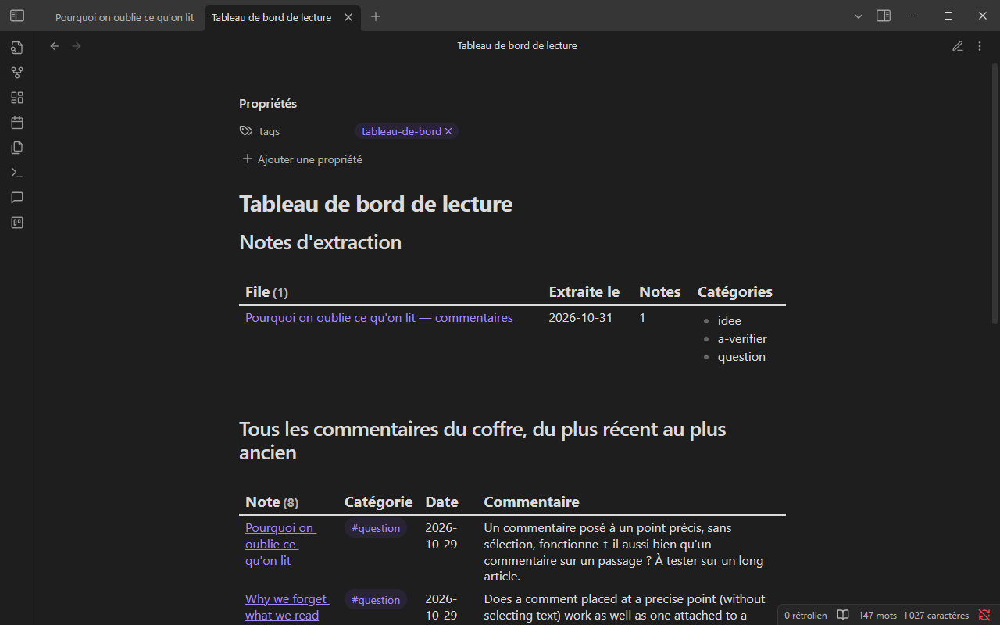

*Pourquoi :* un commentaire ne vaut que si l'on y revient. L'extraction transforme les annotations en matière à retravailler : on les trie, on en écarte, on en fait des tâches ou un texte. Sans cela, elles restent des traces stockées pour le compte de l'utilisateur.

### Utilisation

- **Commenter** : sélectionnez un passage, ou placez simplement le curseur, puis faites un clic droit (« Commenter la sélection » ou « Commenter ici ») ou passez par la palette de commandes. Pour aller plus vite, attribuez un raccourci à la commande *Commenter la sélection ou le curseur* dans *Paramètres → Raccourcis* : Ctrl+Alt+M, celui de Word, est un bon choix. La rédaction s'ouvre dans le panneau de droite, sans masquer le texte. Ctrl+Entrée enregistre, Échap annule.
- **Catégories** : au moment de rédiger, vous pouvez choisir une catégorie (une pastille de couleur). Elle colore le passage et ajoute son tag aux propriétés de la note. Les catégories se règlent dans *Paramètres → Hypomnema* (nom, couleur, tag).
- **Dans la note** : un passage commenté est souligné, et un commentaire posé au curseur s'affiche comme une petite bulle. Un clic sur l'un ou l'autre ouvre le fil dans le panneau.
- **Panneau** : un onglet « Commentaires » est ajouté dans la barre de droite, à côté des rétroliens, des liens sortants et du plan. Il liste les commentaires de la note dans l'ordre du texte. Un clic ramène au passage.
- **Répondre / modifier / supprimer** : ces actions se trouvent sur chaque fil. Supprimer un commentaire retire ses marqueurs et laisse le texte source intact. Ctrl+Z annule.
- **Recherche** : les commentaires étant du texte dans la note, la recherche d'Obsidian les trouve dans tout le coffre. Les tags de catégorie, eux, figurent dans les propriétés et fonctionnent avec `tag:#…`, le volet des tags et Dataview.
- **Marge** (facultative) : *Commentaires en marge* dans les réglages, ou la commande *Afficher ou masquer les commentaires en marge*. Les commentaires s'affichent à côté de leur passage, ou sous le paragraphe quand le panneau est étroit.
- **Extraction** : la commande *Extraire les commentaires de cette note*, ou clic droit sur un dossier → *Extraire les commentaires de ce dossier*. Elle crée une liste, un tableau ou un tableau Kanban dans une note à part. Si cette note existe déjà, elle n'y ajoute que les nouveaux commentaires (par défaut) ou la remplace, selon le réglage.

#### Tags automatiques

Quand un commentaire reçoit une catégorie, le tag correspondant est ajouté à la propriété `tags` de la note. Il est retiré quand plus aucun commentaire de cette catégorie n'y figure, sauf si la note portait déjà ce tag avant. Pour faire la différence, le plugin garde dans `data.json` la liste des tags qu'il a lui-même ajoutés.

### Format (pour les scripts)

Le format est décrit dans la [section anglaise](#storage-format-for-scripts) et vaut à l'identique ici. Le passage commenté est délimité par `%%[aN%%…%%aN]%%` ; un commentaire au curseur est une ancre vide `%%[aN%%%%aN]%%`. Le texte des commentaires se trouve dans un bloc `%% annotations … %%` en fin de note, avec une entrée par commentaire : `[aN] AAAA-MM-JJ #tag texte`, les réponses `[aN.k]` étant indentées.

### Limites

Le plugin fonctionne uniquement en Aperçu en direct : en mode lecture, les marqueurs sont masqués, mais le passage n'est pas souligné. Les fils ne comptent qu'un niveau de réponse, et chaque commentaire n'a qu'une catégorie.

Les commentaires en marge s'affichent en Aperçu en direct et en mode source, pas en mode lecture. La marge a besoin d'espace libre à droite du texte : si la *longueur de ligne lisible* est désactivée, les commentaires passent sous leur paragraphe. Une note d'extraction est une copie : la modifier ne change pas les commentaires de la note source.

### Installer le plugin

En attendant la publication dans le catalogue communautaire, téléchargez `main.js`, `manifest.json` et `styles.css` depuis la [dernière release](https://github.com/Floernt/hypomnema/releases/latest). Copiez-les dans `<coffre>/.obsidian/plugins/hypomnema/`, puis activez le plugin dans *Modules complémentaires*.

---

## Development / Développement

```bash
npm install
npm test          # format tests / tests du format (vitest)
npm run build     # build + copy into test-vault/.obsidian/plugins/
npm run dev       # watch mode / compilation continue
```

`test-vault/` is a sample vault for manual testing. / `test-vault/` est un coffre d'essai.

The tour's screenshots and GIFs are produced by [`scripts/capture.mjs`](scripts/capture.mjs). It drives a separate Obsidian instance opened on `demo-vault/` (see the comments at the top of the script). / Les captures et GIF de la visite sont produits par [`scripts/capture.mjs`](scripts/capture.mjs), qui pilote une instance séparée d'Obsidian ouverte sur `demo-vault/` (mode d'emploi en tête du script).

### Releasing / Publier une version

The version history, including every change to the storage format, is kept in [CHANGELOG.md](CHANGELOG.md).

1. Move the `[Non publié]` entries under a new, dated version number.
2. Set that number in `manifest.json` and `package.json`, and add it to `versions.json` with its `minAppVersion`.
3. Run `npm test`, then `npm run build`, and commit.
4. Push a tag that is exactly that number (no `v`), for example `git tag 0.4.1 && git push origin 0.4.1`. The [release workflow](.github/workflows/release.yml) builds `main.js`, `manifest.json` and `styles.css` from the repository, attests their provenance and publishes the GitHub release with the matching CHANGELOG section. Anyone can check a downloaded file with `gh attestation verify main.js -R Floernt/hypomnema`.

## Contributing / Contribuer

### English

Hypomnema is a young tool, shaped so far by one person's way of reading. Other ways of reading will make it better, and contributions are welcome:

- **Report a bug or suggest an idea** in the [issues](https://github.com/Floernt/hypomnema/issues). For a bug, say which Obsidian version you use, desktop or mobile, and the steps to reproduce it. A short excerpt of the note (with its `%% annotations` block) helps a lot.
- **Propose a change** through a pull request. For anything beyond a small fix, open an issue first so we can agree on the direction before you spend time on it.
- **Translate the interface** into your language (see below). It is the easiest way to start.
- **Fork it.** The licence is MIT: if you want to take the plugin somewhere else, you are free to do so.

A few rules keep the plugin trustworthy, since it writes into people's notes:

- **The storage format is a promise.** Notes written with an older version must keep working. Any change to the format must be backward compatible, covered by a test in `tests/syntax.test.ts`, and described under a **Format** heading in the [CHANGELOG](CHANGELOG.md).
- **Each change adds an entry** to the `[Non publié]` (unreleased) section of the CHANGELOG. Entries are written in French for now; English is fine, it will be translated.
- **Before submitting**, run `npm test` and `npm run build`, and try the change in `test-vault/`, ideally on mobile too.
- **Follow Obsidian's [plugin guidelines](https://docs.obsidian.md/Plugins/Releasing/Plugin+guidelines)**: no default hotkeys, no hard-coded inline styles, public API only.

### Français

Hypomnema est un outil jeune, façonné jusqu'ici par une seule manière de lire. D'autres manières de lire le rendront meilleur, et les contributions sont les bienvenues :

- **Signaler un défaut ou proposer une idée** dans les [issues](https://github.com/Floernt/hypomnema/issues). Pour un défaut, précisez la version d'Obsidian, ordinateur ou mobile, et les étapes pour le reproduire. Un court extrait de la note (avec son bloc `%% annotations`) aide beaucoup.
- **Proposer une modification** par une pull request. Au-delà d'une petite correction, ouvrez d'abord une issue, pour convenir de la direction avant d'y consacrer du temps.
- **Traduire l'interface** dans votre langue (voir ci-dessous). C'est la manière la plus simple de commencer.
- **Forker le projet.** La licence est MIT : si vous voulez emmener le plugin ailleurs, vous en êtes libre.

Quelques règles garantissent la fiabilité du plugin, puisqu'il écrit dans les notes de ses utilisateurs :

- **Le format de stockage est un engagement.** Les notes écrites avec une version antérieure doivent continuer à fonctionner. Toute évolution du format doit être rétrocompatible, couverte par un test dans `tests/syntax.test.ts`, et décrite sous une rubrique **Format** du [CHANGELOG](CHANGELOG.md).
- **Chaque modification ajoute une entrée** à la section `[Non publié]` du CHANGELOG.
- **Avant de soumettre**, lancez `npm test` et `npm run build`, et essayez la modification dans `test-vault/`, idéalement aussi sur mobile.
- **Respectez les [règles des plugins Obsidian](https://docs.obsidian.md/Plugins/Releasing/Plugin+guidelines)** : pas de raccourci par défaut, pas de style en ligne codé en dur, uniquement l'API publique.

### Translations / Traductions

The interface follows Obsidian's language and falls back to English. / L'interface suit la langue d'Obsidian et revient à l'anglais par défaut.

To add a language / Pour ajouter une langue :

1. In [`src/i18n.ts`](src/i18n.ts), copy the `en` dictionary into a new one typed `Record<Key, string>` (TypeScript flags any missing key). / Dans [`src/i18n.ts`](src/i18n.ts), copiez le dictionnaire `en` dans un nouveau dictionnaire typé `Record<Key, string>` (TypeScript signale toute clé manquante).
2. Register it in `locales` under Obsidian's language code. / Déclarez-le dans `locales` sous le code de langue d'Obsidian.
3. Translate `defaultCategoryName` and `defaultCategoryTag` too: they name the sample category created on first install. / Traduisez aussi `defaultCategoryName` et `defaultCategoryTag`, qui nomment la catégorie d'exemple créée à la première installation.
4. Open a pull request, and add yourself below. / Ouvrez une pull request et ajoutez votre nom ci-dessous.

- [x] English (`en`)
- [x] Français (`fr`)
- [ ] Nederlands (`nl`)
- [ ] Deutsch (`de`)
- [ ] Español (`es`)
- [ ] Italiano (`it`)
- [ ] Português (`pt`, `pt-br`)
- [ ] Polski (`pl`)
- [ ] Русский (`ru`)
- [ ] Українська (`uk`)
- [ ] 日本語 (`ja`)
- [ ] 한국어 (`ko`)
- [ ] 简体中文 / 繁體中文 (`zh-cn`, `zh-tw`)

Missing your language? Add it to the list. / Votre langue manque ? Ajoutez-la à la liste.

## License / Licence

MIT. See [LICENSE](LICENSE).
